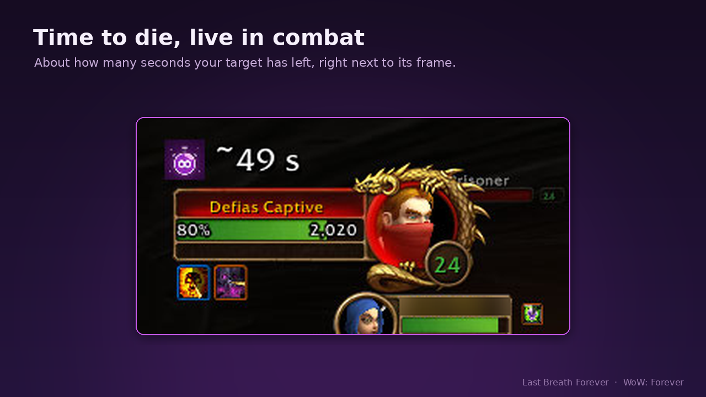
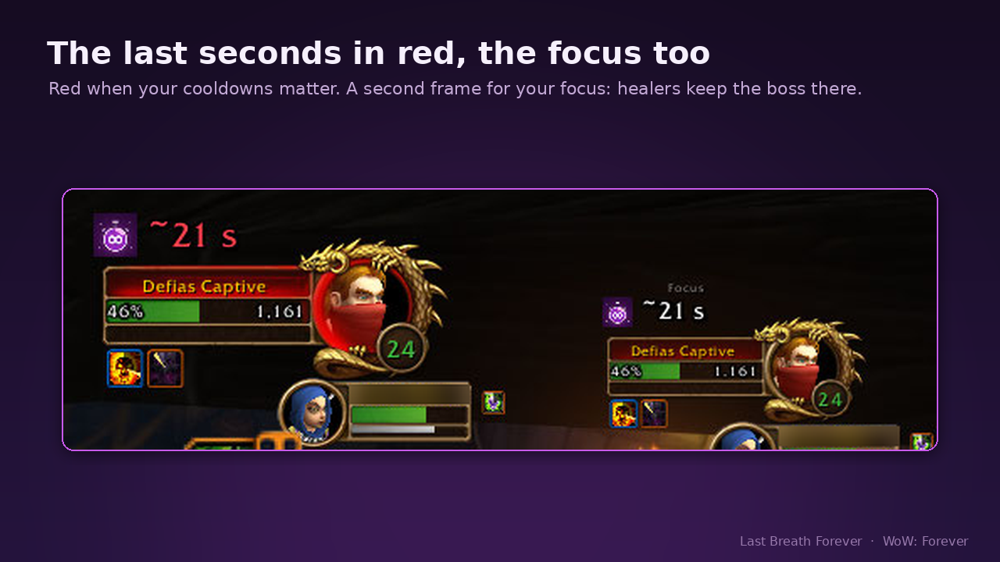
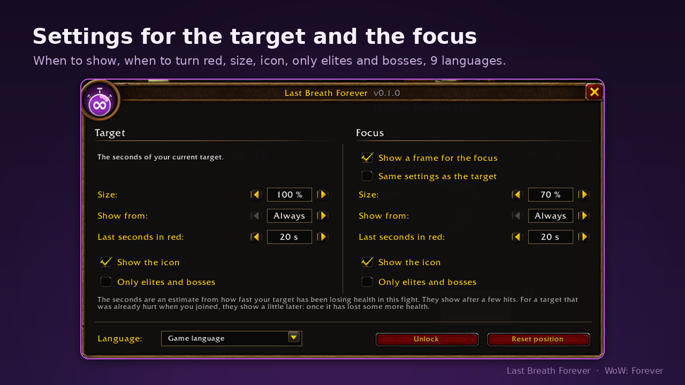

# Last Breath Forever – time to die addon for WoW Forever

**Download:** [CurseForge](https://www.curseforge.com/wow/addons/last-breath-forever) (CurseForge app) · [latest release on GitHub](https://github.com/KesaObscura/LastBreathForever/releases/latest)

An addon for **World of Warcraft: Forever** (WoW Forever, "Classic+", client 1.60.1): **time to
die (TTD)** for your target, your focus and every enemy on its nameplate. See **about how many
seconds your target has left** ("~12 s", longer times as "~2:30" or "~12 min"), live in combat:
finish the long cast, switch targets, see which mob of a pull dies first, or save the potion and
the cooldown for the last seconds. Solo, in a group, in dungeons and on bosses. Part of the
Forever series with [Full Mana Forever](https://github.com/KesaObscura/FullManaForever).

| The last seconds in red, the focus too | Settings for the target, the focus and the nameplates |
|---|---|
|  |  |

## Time to die: what it shows

- **About how many seconds your target has left**, worked out from how fast it has been losing
  health in this fight. Always "about", never exact: when the damage changes a lot, the number
  follows with a delay.
- **No number is better than a wrong one.** The seconds appear once the target has lost a few
  percent; in a group or on a boss also after about 10 s, because the first seconds of a pull say
  too little. Meanwhile a dim icon shows that the addon is counting.
- **Joined late?** A target that was already hurt gets its seconds too, a little later: once it
  has lost some more health.
- **Follows enemies by their nameplates**, also while they are not your target: take one into
  your target and its seconds are there at once. Bosses and adds alike, also in dungeons.
- **Time to die on nameplates**: small seconds above every enemy that is being hit, also the
  target's and the focus's: see which mob of a pull goes down first. The same enemy shows the
  same number everywhere. Only for the last 30 s by default (up to 1:30), right above the
  enemy's name; size, height and the rest can be set.
- **Last seconds in red**: from 5 s up to a minute before the end (10 s by default), for the
  cooldowns, trinkets and potions you keep for the finish.
- **Focus frame** (optional): a second frame with the seconds of your focus, with the target
  frame's settings or its own. **Healers**: put the boss in your focus, and its seconds stay on
  screen while an ally is your target.
- **Show from**: only once about 30 s, 1, 2, 5 or 10 minutes or less are left, or always.
- **Only elites and bosses**, size, icon, position: settings in three columns, target, focus and nameplates.
- **9 languages**: English, Deutsch, Español (EU and AL), Français, Русский, 한국어, Português,
  简体中文, 繁體中文. The addon follows your game language, or choose one in the settings.

## Commands

| Command | What it does |
|---|---|
| `/lbf` | Opens the settings (also: the addon menu at the minimap) |
| `/lbf unlock` | Lets you drag the seconds where you want them |
| `/lbf lock` | Locks them in place (a fight locks them too) |
| `/lbf reset` | Puts them back in the middle of the screen |
| `/lbf check` | Shows what the game answered in the last fights (for bug reports) |
| `/lbf help` | Lists the commands |

## Install

With the [CurseForge](https://www.curseforge.com/wow/addons/last-breath-forever) app, or unzip into `World of Warcraft/_forever_/Interface/AddOns/` (folder `LastBreathForever`).

## Bug reports and ideas

[Issues on GitHub](https://github.com/KesaObscura/LastBreathForever/issues). Please add the lines
of `/lbf check`, your class and level, and what you expected.

License: MIT.
